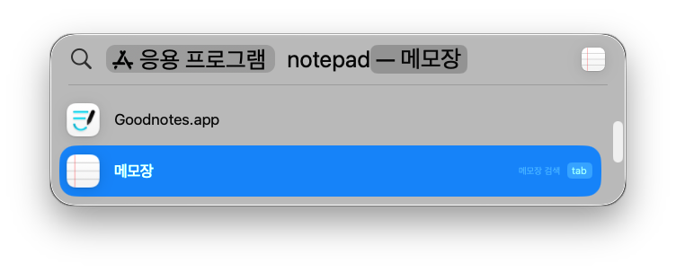

# homebrew-notepad-app

[English](README.md) | **한국어**

  

macOS 텍스트 편집기(TextEdit)를 Spotlight에서 **notepad** / **메모장**으로 실행할 수 있게 합니다.

설치하면:

- `Notepad.app` 래퍼 앱을 만듭니다. 실행하면 텍스트 편집기를 엽니다.
  - 파일 이름은 `Notepad.app`, 한국어 로케일 표시 이름은 `메모장`입니다.
- 텍스트 편집기의 현재 설정을 백업하고 다음과 같이 바꿉니다.
  - 새로운 문서 형식: 일반 텍스트 (`RichText = false`)
  - 스마트 따옴표 끄기 (`SmartQuotes = false`)

제거하면 래퍼 앱을 지우고 텍스트 편집기 설정을 백업해 둔 값으로 되돌립니다.

## 설치 / 제거

```sh
brew tap shapelayer/notepad-app
brew install --cask notepad
```

```sh
brew uninstall --cask notepad
```

`--appdir=~/Applications` 처럼 설치 위치를 바꿀 수 있습니다 (기본값 `/Applications`).

Homebrew 없이 쓰려면 `scripts/install.sh [앱 폴더]`, `scripts/uninstall.sh`를 직접 실행하세요.

## 주의

- **터미널의 "다른 앱 데이터 접근" 권한이 필요합니다.** 텍스트 편집기는 `~/Library/Containers/com.apple.TextEdit` 에 설정이 위치합니다. 접근이 막혀 있으면 권한을 줘야 하는 앱(이름과 번들 ID)을 안내하고,
  권한이 생길 때까지 기다립니다. 시스템 설정 > 개인정보 보호 및 보안 > 전체 디스크 접근 권한에서 그 앱을 켜면 자동으로 계속합니다.
  - 권한 획득을 위해 설치가 잠시 중단되었을 때, **s 키**를 눌러 텍스트 편집기 설정을 건너뛸 수 있습니다.
- 설정 백업은 `~/Library/Application Support/notepad-app/`에 저장됩니다. 재설치해도 처음 백업한 값을 유지하므로
  제거하면 이 도구를 처음 설치하기 전 값으로 돌아갑니다.
